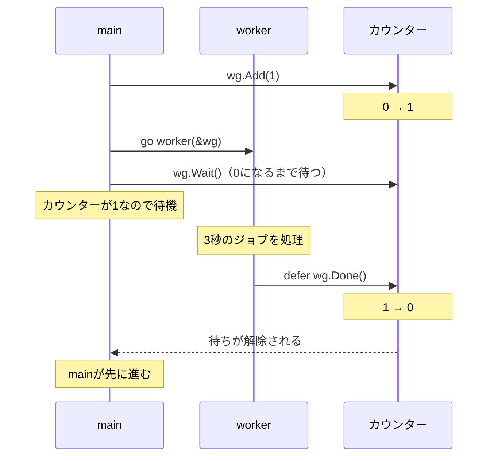
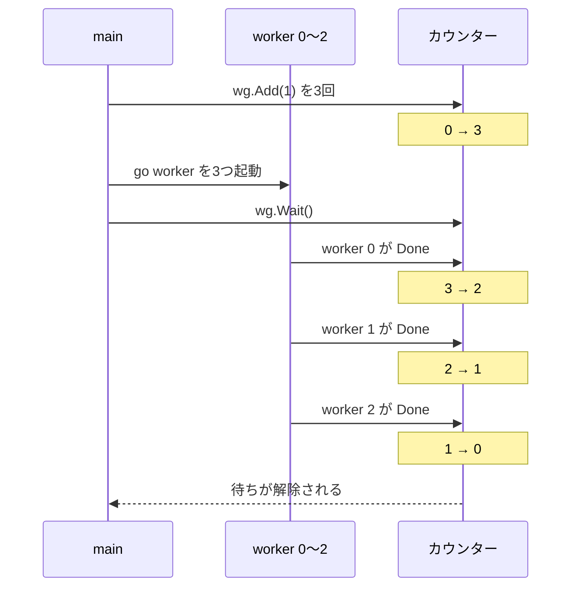
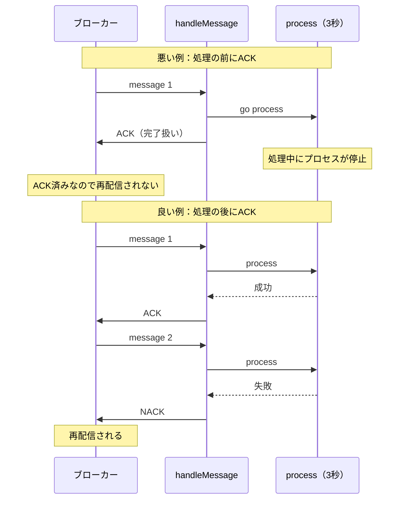
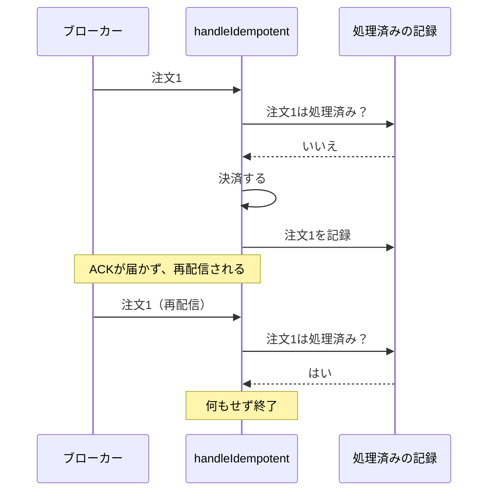
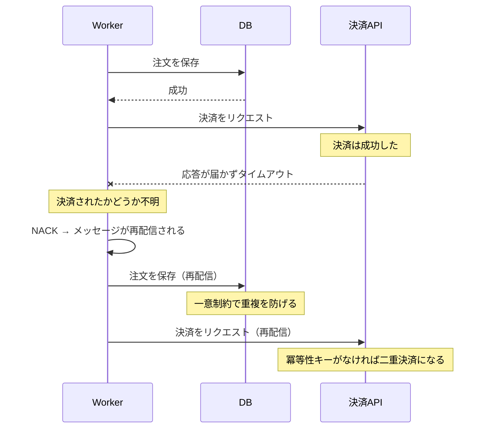

## はじめに

Go言語といえば並列処理が得意というイメージをする人が多いかもしれません。

Goのgoroutineは、少ない記述で並行処理を始められる便利な仕組みです。一方で、`go` を付けて関数を起動するだけでは、終了管理や同時実行数、処理失敗時の扱いまでは考えられていません。

この記事では、goroutineを使った処理を次の3段階で整理します。

1. goroutineの起動と終了を管理する
2. Worker Poolで同時実行数を制御し、Graceful Shutdownを実現する
3. 非同期メッセージ処理で、再配信や二重処理、データ整合性を考える

段階を追って、単に「並行して動かす」状態から「運用を想定して制御する」状態へ改善します。

### この記事でわかること

- goroutineの起動後に、終了を待つ・止める方法（WaitGroup、channel、context）
- Worker Poolで同時実行数を制御し、Graceful Shutdownで安全に停止する考え方
- Pub/Subなどの非同期メッセージ処理で、ACKや冪等性をどう考えるか

## goroutineとは

goroutineは、Goのランタイムが管理する軽量な実行単位です。関数を呼び出すときに `go` を付けると、その関数を別の流れで実行できます。

通常の関数呼び出しでは、呼び出した関数が終わるまで次の行に進みません。`go` を付けると、呼び出し元はすぐ次の行に進み、関数は裏で並行して動きます。

```go
func task(name string) {
    // 時間のかかる処理
}

func main() {
    task("A")    // Aが終わるまでBは始まらない
    task("B")

    go task("A") // Aは裏で動き、mainはすぐ次へ進む
    go task("B") // AとBが並行して動く
}
```

goroutineは軽量なので、数百〜数千個を同時に起動することも一般的です。一方で、`main` 関数が終わるとプログラム全体が終了し、動作中のgoroutineも止まります。そのため、goroutineを起動したあとに「終わるまで待つ」「止める」という管理が必要になります。この記事の後半では、その管理方法を段階的に扱います。

### goroutineが役立つ場面

- 複数のHTTPリクエストを同時に送り、すべての結果をまとめて受け取る
- 画像変換やファイル処理など、時間のかかる処理を並行して進める
- キューから届いた仕事を、裏のWorkerで順番に処理する（Phase 2・Phase 3で扱う内容）
- 処理にタイムアウトやキャンセルを設け、途中で止められるようにする（Phase 1のcontextで扱う内容）

### 主に利用したライブラリとそのバージョン

この記事のコードは、Goの標準ライブラリのみを使っています。

| ライブラリ                | バージョン |
| ------------------------- | ---------- |
| Go                        | 1.27.4     |
| sync（標準ライブラリ）    | Goに同梱   |
| context（標準ライブラリ） | Goに同梱   |
| time（標準ライブラリ）    | Goに同梱   |

Pub/Subなどのメッセージングサービスの具体的なSDKは使わず、ACK/NACKは概念的な例として示しています。

## Phase 1：goroutineを起動するだけでは不十分

### まずはgoroutineを起動する

goroutineは、関数呼び出しの前に `go` を付けることで起動できます。

```go
func worker() {
    fmt.Println("start job")
    time.Sleep(3 * time.Second) // 重い処理を想定して3秒待機する
    fmt.Println("done job")
}

func main() {
    go worker()

    fmt.Println("main: ジョブをworkerに任せた")
    fmt.Println("main: 終了する")
}
```

実行結果の例です。

```
main: ジョブをworkerに任せた
main: 終了する
```

`done job` は表示されません。`start job` も、表示されるかどうかは実行のたびに変わります。`main` が先に終わってプログラムが終了し、workerが途中で打ち切られるためです。

この記事のコードでは、重い処理を想定して `time.Sleep(3 * time.Second)` で3秒待機しています。実際にAPI呼び出しやDB保存などを行うわけではなく、「1つのジョブに3秒かかる」場合の動きを確認するための待機です。実務では、ここに外部APIの呼び出しやDBへの保存、画像変換といった本物の処理が入ります。

ただし、このコードには問題があります。`main`
関数が終了するとプログラム自体が終了するため、起動したgoroutineの処理が完了する保証はありません。

goroutineを起動することと、その終了を管理することは別です。

### WaitGroupで終了を待つ

複数のgoroutineの終了を待つには、`sync.WaitGroup` を使えます。

```go
func worker(wg *sync.WaitGroup) {
    defer wg.Done()

    fmt.Println("start job")
    time.Sleep(3 * time.Second) // 重い処理を想定して3秒待機する
    fmt.Println("done job")
}

func main() {
    var wg sync.WaitGroup

    wg.Add(1)
    go worker(&wg)

    // workerが裏で動いている間、mainは別の仕事を続けられる
    fmt.Println("main: ジョブをworkerに任せた")
    for i := 1; i <= 2; i++ {
        time.Sleep(1 * time.Second)
        fmt.Println("main: 別の仕事をしている", i)
    }

    fmt.Println("main: workerの完了を待つ")
    wg.Wait()
    fmt.Println("main: 完了")
}
```

`Add` で待つgoroutineの数を登録し、goroutineの処理が終わったら `Done`
を呼びます。`Wait` は登録された処理がすべて終わるまで待機します。

#### Add・Done・Waitの関係

`WaitGroup` は内部に「待つ仕事の数」を数えるカウンターを持っています。3つのメソッドは、このカウンターを介してつながっています。

| 呼び出し    | カウンターの動き | 意味                           |
| ----------- | ---------------- | ------------------------------ |
| `wg.Add(1)` | +1               | 待つ仕事が1つ増えたと登録する  |
| `wg.Done()` | −1               | 仕事が1つ終わったと知らせる    |
| `wg.Wait()` | 0になるまで待つ  | すべて終わるまで、ここで止まる |

上のコードでは、次のように動きます。



つまり、`Add` と `Done` でカウンターを増減させ、`Wait` はそのカウンターが 0 になるのを待つ、という関係です。

使うときのポイントは次の2つです。

- `Add` は、`go` でgoroutineを起動する**前**に呼びます。起動後に呼ぶと、`Add` より先に `Wait` が実行され、待たずに抜けてしまう可能性があります。
- `Done` は、`defer wg.Done()` としてworkerの先頭に書きます。呼び忘れるとカウンターが 0 にならず、`Wait` が永遠に終わりません。

`Done` と `defer` の相性がよいのは、`defer` が「関数を抜けるときに必ず実行する」仕組みだからです。途中で `return` しても、エラーやpanicで抜けても、`defer` した `Done` は呼ばれます。「どんな終わり方でも、必ずカウンターを減らす」ことを、先頭の1行で保証できます。

workerが複数ある場合は、その数だけ `Add(1)` を呼びます。たとえば3つのworkerを起動するなら、カウンターが 3 → 2 → 1 → 0 と減り、0 になった時点で `Wait` が解除されます。



実行結果の例です。workerが3秒のジョブを処理している間も、`main` は別の仕事を続けています。`main` は自分の仕事が終わったあと、`wg.Wait()` でworkerの完了を待ちます。

```
main: ジョブをworkerに任せた
start job
main: 別の仕事をしている 1
main: 別の仕事をしている 2
main: workerの完了を待つ
done job
main: 完了
```

`main: ジョブをworkerに任せた` と `start job` の順番は、実行のたびに入れ替わることがあります。

### channelで仕事を受け渡す

goroutine間でデータを受け渡すにはchannelを使います。

#### なぜchannelが必要なのか

WaitGroupでできるのは「終わるのを待つ」ことだけです。`go worker()` で起動したあとに、`main` からworkerへ「この仕事をやって」とデータを渡す手段はありません。

引数で渡す方法もありますが、起動時に1回しか渡せません。実際の処理を考えると、これでは足りない場面がほとんどです。

- **外部APIの呼び出し**: ユーザーの操作のたびに「この注文を決済サービスに送る」という仕事が発生します。注文が何件来るかは、workerを起動した時点ではわかりません。届くたびにworkerへ渡す必要があります。
- **DBへの保存**: アクセスログや計測データを、1件ずつ待たずに裏でまとめて保存したい場合、保存したいデータは次々に発生します。起動時の引数に最初から全部入れておくことはできません。
- **画像変換**: ユーザーが画像をアップロードするたびに、サムネイル作成などの変換が必要になります。アップロードは起動後に何度も起こるので、1つのworkerに続けて何件も渡せる必要があります。

つまり「仕事があとから、何件発生するかわからない形で届く」場合に、起動済みのworkerへ仕事を渡す手段が必要になります。

そこで、goroutine同士がデータをやり取りするための通り道としてchannelを使います。送る側が `jobs <- 1` と書き込み、受け取る側が `for job := range jobs` で読み出します。

channelを使わず、複数のgoroutineが同じ変数を直接書き換えて受け渡すこともできますが、同時に書き込まれてデータが壊れる（データ競合）危険があります。channelなら、受け渡しの順序と排他制御をGoが保証してくれるため、安全に仕事を渡せます。

また、channelには次の性質があります。

- 受け取る側がいなければ、送る側は待たされる（バッファーなしの場合）
- `close` によって、「これ以上仕事は来ない」と受け取る側に伝えられる

この2つのおかげで、「仕事を渡す」と「終わりを伝える」を同じ仕組みで扱えます。

#### コードで確認する

channelで送る数値は、ただ表示するだけではなく、workerが処理に使います。ここでは数値を「画像ID」とみなし、workerが `convertImage` でその画像を変換する例にします。

```go
// 画像変換を想定した関数。受け取った数値を画像IDとして使い、サムネイルのファイル名を返す
func convertImage(imageID int) string {
    time.Sleep(3 * time.Second) // 重い処理を想定して3秒待機する
    return fmt.Sprintf("image_%d_thumb.jpg", imageID)
}

func worker(jobs <-chan int, wg *sync.WaitGroup) {
    defer wg.Done()

    for job := range jobs {
        fmt.Printf("start: 画像 %d を変換\n", job)
        thumbnail := convertImage(job)
        fmt.Printf("done: %s を作成\n", thumbnail)
    }
}

func main() {
    jobs := make(chan int)

    var wg sync.WaitGroup
    wg.Add(1)
    go worker(jobs, &wg)

    // jobsはバッファなしなので、workerが受け取るまで送信側のmainは待たされる
    fmt.Println("main: job 1 を送る")
    jobs <- 1
    fmt.Println("main: job 1 を送り終えた")

    fmt.Println("main: job 2 を送る")
    jobs <- 2 // workerがjob 1を処理中のため、ここで約3秒待たされる
    fmt.Println("main: job 2 を送り終えた")

    close(jobs)
    fmt.Println("main: workerの完了を待つ")
    wg.Wait()
    fmt.Println("main: 完了")
}
```

`close(jobs)`によって、これ以上仕事が送られないことをWorkerに伝えます。`for range`
はchannelが閉じられ、バッファー内の値もなくなると終了します。

実行結果の例です。Workerは1つだけなので、1件目が終わってから2件目が始まり、全体で約6秒かかります。

```
main: job 1 を送る
main: job 1 を送り終えた
main: job 2 を送る
start: 画像 1 を変換
done: image_1_thumb.jpg を作成
start: 画像 2 を変換
main: job 2 を送り終えた
main: workerの完了を待つ
done: image_2_thumb.jpg を作成
main: 完了
```

ここで注目したいのは `main` の動きです。`jobs` はバッファのないchannelなので、送信側の `main` は、Workerが受け取るまで待たされます。Workerが1件目を処理している間、`jobs <- 2` は約3秒止まり、1件目が終わってWorkerが受け取れる状態になってから `main` は先へ進みます。

### contextでキャンセルを伝える

`WaitGroup`は終了を待つ仕組みですが、処理を止める指示を出すものではありません。キャンセルを伝えるには`context` を使います。

#### どんなときに処理を止めたいのか

workerは仕事を待ち続けるので、放っておくと自分では止まりません。外から「止まってほしい」と伝える必要があるのは、たとえば次のような場面です。

- **アプリを停止・再起動するとき**: デプロイやスケールインのたびに、動いているworkerを止める必要があります。止める合図がなければ、`wg.Wait()` はいつまでも終わりません（Phase 2のGraceful Shutdownにつながります）。
- **ユーザーが操作を中断したとき**: 画像変換を依頼したあと、ユーザーがブラウザを閉じたり、キャンセルボタンを押したりした場合、結果を受け取る人はもういません。変換を続けても、CPUを無駄に使うだけです。
- **処理が時間内に終わらないとき**: 外部APIが応答しない場合に、何十秒も待ち続けるのではなく、「5秒で諦める」ようにします。待ち続けると、workerが塞がって次の仕事を処理できなくなります。
- **ほかの処理が失敗したとき**: 複数のAPI呼び出しを並行して行い、どれか1つが失敗したら全体が失敗になる場合、残りの呼び出しを続けても意味がありません。DBへの保存など、それ以降の処理も止めたほうが安全です。

どの場面も、「処理を行っているgoroutineに、外から止まってほしいと伝える」点は同じです。その合図を、goroutineの呼び出し元から渡す仕組みが `context` です。

```go
func worker(ctx context.Context, id int, jobs <-chan int) {
    for {
        select {
        case <-ctx.Done():
            fmt.Printf("worker %d: stopped: %v\n", id, ctx.Err())
            return
        case job := <-jobs:
            fmt.Printf("worker %d: start 画像 %d を変換\n", id, job)
            thumbnail := convertImage(job)
            fmt.Printf("worker %d: done %s を作成\n", id, thumbnail)
        }
    }
}
```

`select` で、キャンセル通知（`ctx.Done()`）と仕事の受信（`jobs`）を同時に待ちます。`default` を置いて何もせずループすると、CPUを消費し続けてしまうため注意が必要です。

呼び出し側は `context.WithCancel`
でキャンセル可能なContextを作り、`cancel()` で終了を通知できます。

```go
func main() {
    ctx, cancel := context.WithCancel(context.Background())
    defer cancel()

    jobs := make(chan int)

    // workerを2つ起動する。2つの仕事を同時に処理できる
    var wg sync.WaitGroup
    for i := 1; i <= 2; i++ {
        wg.Add(1)
        go func(id int) {
            defer wg.Done()
            worker(ctx, id, jobs)
        }(i)
    }

    fmt.Println("main: job 1 を送る")
    jobs <- 1
    fmt.Println("main: job 2 を送る")
    jobs <- 2
    time.Sleep(100 * time.Millisecond)

    // 必要なタイミングで終了を要求
    fmt.Println("main: cancelする（job 1, 2は処理中）")
    cancel()
    wg.Wait()
    fmt.Println("main: 完了")
}
```

実行結果の例です。

```
main: job 1 を送る
main: job 2 を送る
worker 1: start 画像 1 を変換
worker 2: start 画像 2 を変換
main: cancelする（job 1, 2は処理中）
worker 1: done image_1_thumb.jpg を作成      ← 約3秒後
worker 2: done image_2_thumb.jpg を作成
worker 1: stopped: context canceled
worker 2: stopped: context canceled
main: 完了
```

2つのWorkerが、2件の仕事を同時に処理しています。`cancel()` を呼んだ時点では、どちらも処理の途中です。`cancel()` は処理中の仕事を途中で止めません。それぞれの仕事が終わって次のループで `ctx.Done()` が選ばれ、はじめて両方のWorkerが停止します。

Workerが1つだと、2件目の仕事はWorkerが空くまで待たされ、動きが読み取りにくくなります。そのため、このサンプルでは2つ起動しています。複数のWorkerで仕事を分担する考え方は、Phase 2のWorker Poolで詳しく扱います。

### Phase 1のポイント

- goroutineは起動しただけでは終了を管理できない
- `WaitGroup` はgoroutineの終了を待つ
- channelはgoroutine間のデータ受け渡しに使う
- `close` は送信側が「これ以上送らない」と伝える
- `context` はキャンセルや期限を伝える

**改善の考え方：**
goroutineを起動するだけでなく、仕事の受け渡し方と終了条件を設計する。

## Phase 2：Worker PoolとGraceful Shutdown

Phase1ではgoroutineの起動・終了を学びました。次は、仕事が大量に届く場合を考えます。

### Workerの使われ方：バッチ型と常駐型

Workerの使い方には、大きく2つの形があります。

**バッチ型**は、処理する仕事の数があらかじめ決まっている形です。仕事を全部渡したらchannelを閉じ、すべて終わったらプログラムも終了します。この記事のPhase 1や、このあとのWorker Poolのサンプルはこの形です。

**常駐型**は、アプリの起動時にWorkerを起動しておき、停止するまで仕事を待ち続ける形です。サーバーやPub/Subの購読処理など、実務で多いのはこちらです。

```
起動時:  Workerを3つ起動し、jobsを待ち続ける
実行中:  リクエストやメッセージが届く → jobs <- job → 空いているWorkerが処理する
停止時:  新しい仕事の受付を止める → 処理中の仕事の完了を待つ → 終了
```

常駐型では、仕事がいつ・何件届くかは起動時にはわかりません。だからこそ、Phase 1で見たように、起動済みのWorkerへchannelで仕事を渡す仕組みが必要になります。また、停止するタイミングは運用側（デプロイや再起動など）が決めるため、あとで扱うGraceful Shutdownが重要になります。

なお、Goの標準のHTTPサーバーは、リクエストごとに自動でgoroutineを起動します。リクエストを受けるだけならWorker Poolは不要です。Worker Poolが使われるのは、リクエストの裏で画像変換、外部APIの呼び出し、メール送信などの重い処理を、同時実行数を制限しながら非同期に進めたい場合です。

以降のサンプルは、動作を確認しやすいように、仕事を最初にまとめて送るバッチ型の形で書いています。

### goroutineを無制限に起動する問題

例えば、100件の仕事を次のように処理するとします。

```go
for _, job := range jobs {
    go process(job)
}
```

この方法では仕事の数だけgoroutineが起動します。仕事が大量に届くと、同時実行数が増えすぎて、CPUやメモリ、DB接続などのリソースを圧迫する可能性があります。

具体的には、仕事の中身によって次のような問題が起きます。

- **外部APIの呼び出し**: 100件を同時に送ると、相手のAPIのレート制限（例：1秒あたり10リクエストまで）を超えてエラーになったり、相手のサービスに負荷をかけたりします。
- **DBへの保存**: DBの接続数には上限があります（例：最大20接続）。100個のgoroutineが同時に接続しようとすると、接続待ちやエラーが発生し、DB自体も遅くなります。
- **画像変換**: 画像変換はCPUとメモリを大量に使います。数百枚を同時に変換すると、メモリが足りなくなってプロセスが落ちる可能性があります。

どれも「仕事自体は正しいのに、同時に実行しすぎることで壊れる」問題です。

そこでWorker Poolを使います。Workerの数を「APIのレート制限内に収まる数」「DB接続数の上限以下」「CPUコア数に見合った数」のように決めておけば、仕事が何件届いても、同時に動くのはその数までに抑えられます。

### Worker Poolで同時実行数を制御する

Worker
Poolでは、決められた数のWorkerを起動し、channel経由で仕事を渡します。

```go
func worker(id int, jobs <-chan int, wg *sync.WaitGroup) {
    defer wg.Done()

    for job := range jobs {
        fmt.Printf("worker %d: start 画像 %d を変換\n", id, job)
        thumbnail := convertImage(job)
        fmt.Printf("worker %d: done %s を作成\n", id, thumbnail)
    }
}

func main() {
    jobs := make(chan int)
    var wg sync.WaitGroup

    // workerを3つだけ起動する。仕事が10件あっても、同時に処理されるのは最大3件
    workerCount := 3

    for i := 0; i < workerCount; i++ {
        wg.Add(1)
        go worker(i, jobs, &wg)
    }

    for job := 1; job <= 10; job++ {
        // 3つのworkerがすべて処理中の間、mainはここで待たされる
        fmt.Printf("main: job %d を送る\n", job)
        jobs <- job
    }

    close(jobs)
    fmt.Println("main: workerの完了を待つ")
    wg.Wait()
    fmt.Println("main: 完了")
}
```

この例ではWorkerを3つだけ起動しています。仕事が10件あっても、同時に仕事を処理するWorkerは最大3つです。

実行結果の例です（一部を抜粋しています）。

```
main: job 1 を送る
main: job 2 を送る
main: job 3 を送る
main: job 4 を送る        ← 3つのworkerが処理中のため、job 4 は受け取り待ち
worker 2: start 画像 3 を変換
worker 1: start 画像 2 を変換
worker 0: start 画像 1 を変換
worker 0: done image_1_thumb.jpg を作成      ← 約3秒後
worker 0: start 画像 4 を変換     ← 空いたworkerが次の仕事を受け取る
...
main: 完了                 ← 全体で約12秒
```

3秒のジョブが10件あるので、Workerが1つなら約30秒かかります。3つなら約12秒（3件ずつ処理して4ラウンド）で終わり、かつ同時実行数は常に3以下に保たれます。なお、同時に動くworkerの表示順は実行のたびに変わります。

### Graceful Shutdownとは

サーバーやWorkerを停止するとき、いきなりプロセスを終了すると処理中の仕事が中断される可能性があります。

具体的には、仕事の中身によって次のような問題が起きます。

- **外部APIの呼び出し**: 決済APIにリクエストを送った直後にプロセスが止まると、相手側では決済が完了しているのに、こちらは結果を受け取れず記録も残せません。ユーザーに二重請求してしまう可能性もあります。
- **DBへの保存**: 複数のテーブルを更新している途中で止まると、中途半端なデータが残ります（例：注文は保存されたが、在庫が減っていない）。
- **画像変換**: 変換の途中で止まると、壊れた画像ファイルや、中途半端な一時ファイルが残ります。

デプロイや再起動のたびに、このような中断が起こり得ます。

Graceful
Shutdownは、新しい仕事の受付を止め、処理中の仕事を可能な範囲で完了させてから終了する考え方です。

基本的な流れは次のとおりです。

1. シャットダウン要求を受け取る
2. 新しい仕事の受付を止める
3. Workerに終了を伝える
4. 処理中の仕事が終わるのを待つ
5. 制限時間を超えた場合はタイムアウトとして扱う

### context.WithTimeoutで終了期限を設ける

終了を無期限に待つのではなく、期限を設けることも重要です。

```go
func main() {
    // ...（Workerの起動と仕事の送信は省略）

    shutdownCtx, cancel := context.WithTimeout(
        context.Background(),
        10*time.Second,
    )
    defer cancel()
}
```

例えば、Workerの終了を待つ処理を別goroutineで実行し、終了通知とタイムアウトを
`select` で待つことができます。

```go
func main() {
    // ...（Workerの起動、shutdownCtxの作成は省略）

    done := make(chan struct{})

    go func() {
        wg.Wait()
        close(done)
    }()

    select {
    case <-done:
        fmt.Println("all workers stopped")
    case <-shutdownCtx.Done():
        fmt.Println("shutdown timeout:", shutdownCtx.Err())
    }
}
```

処理中の仕事が終わるのを無期限に待つと、外部APIが応答しない、DBのロックが解けないといった場合に、プロセスがいつまでも終了できなくなります。そのため、「最大10秒は待つが、それを超えたら諦める」という期限を設けます。

実際に動かすと、次のようになります（3秒のジョブを3つのWorkerが処理している最中、2秒時点でシャットダウンを要求した場合）。

```
main: job 1 を渡した
main: job 2 を渡した
main: job 3 を渡した
worker 0: start 画像 1 を変換
worker 2: start 画像 2 を変換
worker 1: start 画像 3 を変換
main: 新しい仕事の受付を止めた         ← 2秒後
main: shutdown requested（処理中の仕事の完了を待つ）
worker 1: done image_3_thumb.jpg を作成                    ← 3秒後。処理中の仕事は最後まで完了する
worker 1: stop requested
worker 2: done image_2_thumb.jpg を作成
worker 0: done image_1_thumb.jpg を作成
main: all workers stopped
```

シャットダウンを要求しても、すでに始まっていたjob 1〜3は途中で止まらず、完了してからWorkerが停止します。新しいjob 4は受け付けられていません。

ここで注意したいのは、タイムアウトしたからといって、処理中のgoroutineが自動的に強制終了されるわけではないことです。各Workerや処理関数がContextを確認し、キャンセルに協力する設計が必要です。

### 処理中の仕事をどう扱うか

Graceful Shutdownでは、単に `cancel()` を呼べばよいわけではありません。

例えば、次のような方針を決める必要があります。

- すでに開始した仕事は完了まで待つ
- まだ開始していない仕事は破棄する
- 未処理の仕事をキューや永続ストレージに戻す
- 外部API呼び出しなど、途中でキャンセルできる処理はContextで止める

どの方針が適切かは、仕事の性質や再実行可能性によって変わります。

### Phase 2のポイント

- Worker Poolで同時実行数を制御する
- `WaitGroup` でWorkerの終了を待つ
- channelを閉じて新しい仕事がないことを伝える
- `context.WithCancel` でキャンセルを伝える
- `context.WithTimeout` で終了を待つ期限を設ける
- タイムアウトはgoroutineを強制終了する機能ではない
- 処理中・未処理の仕事をどう扱うか決めておく

**改善の考え方：**
goroutineの数を制御し、停止時にも仕事を安全に扱えるようにする。

## Phase 3：非同期メッセージ処理とデータ整合性

Phase
2までは、主にアプリケーション内のgoroutineやWorkerの制御を扱いました。実務では、Pub/Subなどのメッセージングサービスから仕事を受け取って非同期処理するケースもあります。

ここでは、メッセージを受信して処理するWorkerを考えます。

### メッセージ処理の基本的な流れ

例えば、注文イベントを受信して後続処理を行う場合、概念的には次の流れになります。

1. メッセージを受信する
2. メッセージの内容を検証する
3. 注文に関する処理を実行する
4. 成功したらACKする
5. 失敗したらNACKやリトライなど、システムの方針に従って扱う

ACKはメッセージ処理が完了したことをブローカーに伝える操作です。NACKは処理できなかったことを伝え、再配信などにつなげるために使われます。実際の挙動は利用するメッセージングサービスや設定によって異なります。

### ACKを早く返しすぎない

例えば、処理をgoroutineに渡した直後にACKしてしまうと、実際の処理が終わる前にメッセージが完了扱いになる可能性があります。

```go
func process(m *Message) {
    fmt.Printf("message %d: start processing\n", m.ID)
    time.Sleep(3 * time.Second) // 重い処理を想定して3秒待機する
    fmt.Printf("message %d: processed\n", m.ID)
}

func handleMessage(m *Message) {
    go process(m)
    m.Ack() // 処理完了前にACKしてしまう
}

func main() {
    handleMessage(&Message{ID: 1})

    // 処理中にプロセスが停止した状況（デプロイ・障害・クラッシュなど）を想定する
    time.Sleep(1 * time.Second)
    fmt.Println("main: プロセスが停止する")
}
```

実行結果の例です。

```
message 1: ACK（ブローカーは完了扱いにする）
message 1: start processing
main: プロセスが停止する
```

`message 1: processed` が表示されていません。1秒後にプロセスが停止し、3秒かかる処理が途中で打ち切られたためです。それでもACK済みなので、メッセージは再配信されず、仕事が失われます。具体的には、注文イベントのACKは済んでいるのに、決済も在庫の更新も行われていない状態になります。

基本的には、処理が成功したことを確認してからACKする設計にします。

```go
func process(m *Message) error {
    fmt.Printf("message %d: start processing\n", m.ID)
    time.Sleep(3 * time.Second) // 重い処理を想定して3秒待機する

    // 動作確認しやすいよう、IDが偶数のメッセージは失敗させる
    if m.ID%2 == 0 {
        return errors.New("process failed")
    }
    fmt.Printf("message %d: processed\n", m.ID)
    return nil
}

func handleMessage(m *Message) {
    if err := process(m); err != nil {
        m.Nack()
        return
    }

    m.Ack()
}

func main() {
    for id := 1; id <= 4; id++ {
        handleMessage(&Message{ID: id})
    }
}
```

実行結果の例です。

```
message 1: start processing
message 1: processed
message 1: ACK（完了扱い）
message 2: start processing
message 2: NACK（再配信される）
message 3: start processing
message 3: processed
message 3: ACK（完了扱い）
message 4: start processing
message 4: NACK（再配信される）
```

成功したメッセージ（1, 3）だけがACKされ、失敗したメッセージ（2, 4）はNACKによって再配信の対象になります。途中でプロセスが停止しても、ACKしていないメッセージは再配信されるため、仕事は失われません。

2つのタイミングの違いを図にすると、次のとおりです。



これは概念例です。実際のSDKではACK/NACKのAPIやエラー処理が異なります。

### 再配信による二重処理を考える

メッセージングシステムでは、処理が失敗したりACKが届かなかったりすると、同じメッセージが再配信されることがあります。

そのため、同じ注文イベントを複数回受け取っても、結果が壊れないようにする必要があります。

この考え方を冪等性（idempotency）といいます。

#### 冪等でないと何が起きるか

注文1の処理は成功したのに、ACKがブローカーに届かなかったとします。ブローカーは「処理されていない」と判断して、注文1を再配信します。

冪等でない処理では、届くたびに毎回決済してしまいます。

```go
// 決済API呼び出しを想定した処理
func charge(orderID int) {
    time.Sleep(3 * time.Second) // 重い処理を想定して3秒待機する
    fmt.Printf("  注文 %d: 決済した\n", orderID)
}

// 冪等でない例：届くたびに毎回決済する
func handleNaive(m Message) {
    fmt.Printf("注文 %d を受信\n", m.OrderID)
    charge(m.OrderID)
}
```

注文1が再配信されると、次のように二重に決済されます。

```
=== 冪等でない場合 ===
注文 1 を受信
  注文 1: 決済した
注文 2 を受信
  注文 2: 決済した
注文 1 を受信
  注文 1: 決済した    ← 二重に決済してしまった
```

#### 処理済みかどうかを確認する

処理する前に「この注文IDはすでに処理したか」を確認すれば、再配信されても結果は変わりません。

```go
// processed は、注文IDの一意制約を持つordersテーブルの代わり
var processed = map[int]bool{}

// 冪等な例：処理済みの注文IDは何もしない
func handleIdempotent(m Message) {
    fmt.Printf("注文 %d を受信\n", m.OrderID)
    if processed[m.OrderID] {
        fmt.Printf("  注文 %d: 処理済みなのでスキップ\n", m.OrderID)
        return
    }
    charge(m.OrderID)
    processed[m.OrderID] = true
}
```

同じメッセージが届いても、2回目はスキップされます。

```
=== 冪等な場合 ===
注文 1 を受信
  注文 1: 決済した
注文 2 を受信
  注文 2: 決済した
注文 1 を受信
  注文 1: 処理済みなのでスキップ    ← 再配信されても二重に決済しない
```



ここでは、処理済みの記録をメモリ上のmapで代用しています。実務では、注文IDに一意制約を設定したDBのテーブルに記録します。同じ注文を重複登録できないようにする方法です。

```sql
CREATE TABLE orders (
    id BIGINT PRIMARY KEY,
    amount INTEGER NOT NULL
);
```

ただし、単に一意制約を設けるだけで、あらゆる副作用が安全になるわけではありません。重複時の扱い、更新処理、外部API呼び出しなども含めて設計する必要があります。

### DBトランザクションと整合性

例えば、注文を登録した後に決済サービスを呼び出す場合、DBへの保存と外部サービスへのリクエストは、通常ひとつのDBトランザクションとしてまとめられません。

そのため、次のような問題が起き得ます。

- DB登録は成功したが、外部API呼び出しに失敗した
- 外部APIは成功したが、応答を受け取る前にタイムアウトした
- リトライによって同じ処理が複数回実行された

2つ目の「外部APIは成功したが、応答を受け取る前にタイムアウトした」ケースを図にすると、次のようになります。



DBの一意制約で守れるのは、DBへの二重登録までです。外部APIへのリクエストが二重に実行されるかどうかは、別の仕組みで守る必要があります。たとえば決済APIに「同じ冪等性キーなら一度しか処理しない」ことを任せる方法があります。

こうしたケースでは、冪等性キー、処理状態の管理、トランザクション、Outboxパターンなどを組み合わせて検討します。どの方式を使うかは、求める整合性やシステム構成によって変わります。

### Phase 3のポイント

- 非同期メッセージ処理では、処理完了とACKの順序が重要
- 失敗時のNACKやリトライの挙動を理解する
- メッセージの再配信による二重処理を想定する
- 冪等性を確保し、重複実行でも安全にする
- DBと外部サービスをまたぐ処理では、部分的な失敗を考慮する

**改善の考え方：**
goroutineやWorkerの制御だけでなく、メッセージの再配信、二重実行、障害時のデータ整合性まで設計する。

## 3段階のまとめ

| 段階    | 困りごと                                                 | 解決する仕組み                                 |
| ------- | -------------------------------------------------------- | ---------------------------------------------- |
| Phase 1 | `main` が先に終わり、goroutineの処理が途中で打ち切られる | WaitGroupで終了を待つ                          |
|         | 起動したあとのworkerに、仕事を渡せない                   | channelで仕事を受け渡す                        |
|         | 動き続けるworkerを、外から止められない                   | contextでキャンセルを伝える                    |
| Phase 2 | 仕事の数だけgoroutineが増え、API・DB・メモリが限界になる | Worker Poolで同時実行数を制限する              |
|         | 停止時に、処理中の仕事が中断される                       | Graceful Shutdownとタイムアウト                |
| Phase 3 | 処理が終わる前にACKして、仕事が失われる                  | 処理が成功してからACKし、失敗したらNACKする    |
|         | 再配信されて、同じ処理（決済など）が二重に実行される     | 冪等性（処理済みかどうかの確認、一意制約）     |
|         | DBと外部APIをまたぐ処理で、一部だけ成功した状態になる    | 冪等性キー、処理状態の管理、Outboxパターンなど |

この記事のサンプルコードは、次の順に対応しています。

| フォルダ                       | 内容                                            |
| ------------------------------ | ----------------------------------------------- |
| `phase1/1-1-goroutine`         | goroutineを起動するだけだと、処理が途中で終わる |
| `phase1/1-2-waitgroup`         | WaitGroupで終了を待つ                           |
| `phase1/1-3-channel`           | channelで仕事を渡す                             |
| `phase1/1-4-context`           | contextでキャンセルを伝える                     |
| `phase2/2-1-workerpool`        | Worker Poolで同時実行数を制限する               |
| `phase2/2-2-shutdown`          | Graceful Shutdown                               |
| `phase3/3-1-early-ack`         | 処理の前にACKして、仕事が失われる               |
| `phase3/3-2-ack-after-process` | 処理の後にACKし、失敗したらNACKする             |
| `phase3/3-3-idempotency`       | 冪等性で、再配信されても二重に処理しない        |

goroutineを使ううえで大切なのは、単に並行して処理を実行することではありません。

- いくつ同時に動かすのか
- いつ、どのように止めるのか
- 処理中の仕事をどう扱うのか
- 失敗した仕事をどう再実行するのか
- 同じ仕事が複数回実行されても安全か

こうした点を順番に考えることで、実務で扱える並行処理に近づけます。

## 補足：この記事で扱った範囲

この記事は、goroutine学習で扱ったテーマを3段階に整理したものです。コード例は考え方を示すための簡略化したものを含み、実際の本番実装ではエラー処理、Contextの伝播、ログ、メトリクス、リソース制限、リトライ方針などを追加で設計する必要があります。

また、race condition、deadlock、goroutine
leakの検出・防止や、テスト・ベンチマークについては、別途理解を深めていく必要があります。
