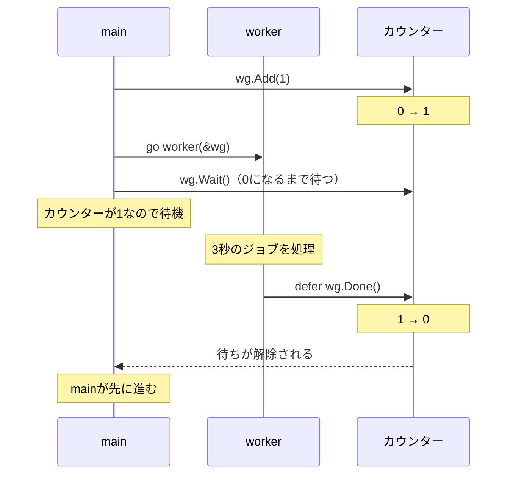
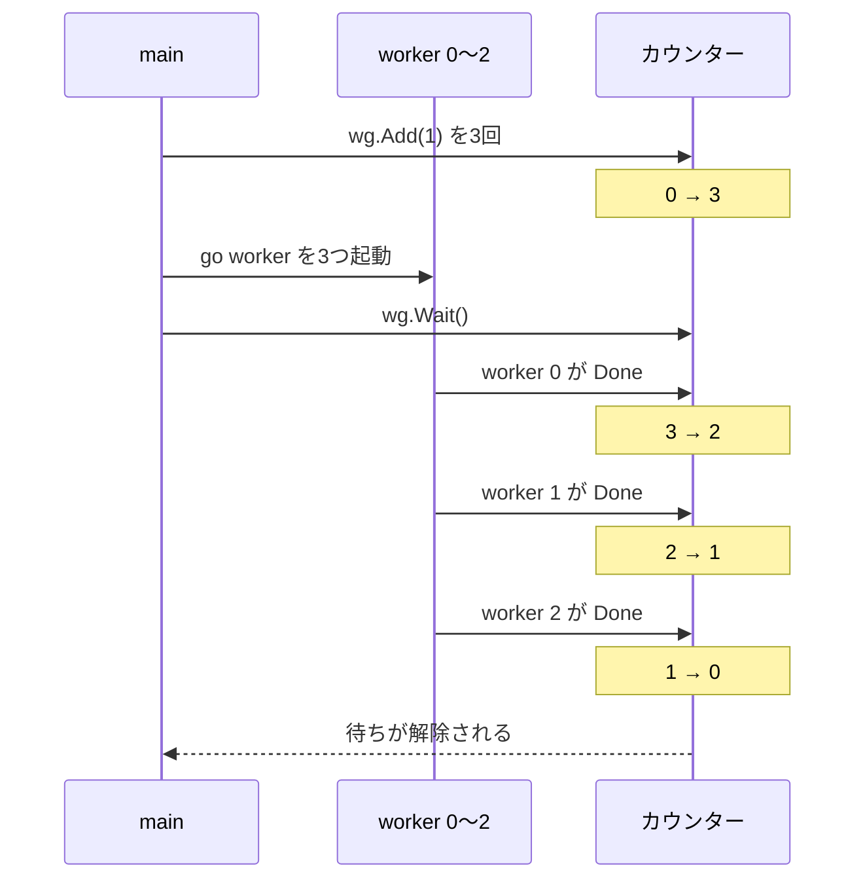
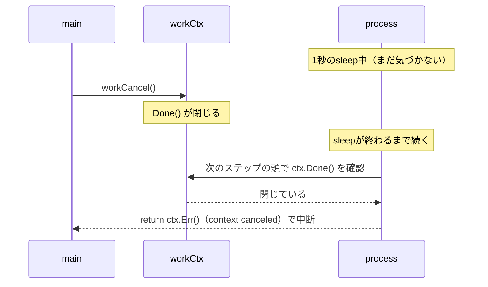

## はじめに

Go言語といえば並行処理が得意というイメージをする人が多いかもしれません。

Goのgoroutineは、少ない記述で並行処理を始められる便利な仕組みです。一方で、`go` を付けて関数を起動するだけでは、終了の待機や同時実行数の制御、停止時の扱いは含まれません。

この記事では、goroutineを使った処理を次の3段階で整理します。

1. goroutineの起動と終了を管理する
2. Worker Poolで同時実行数を制御する
3. Graceful Shutdownで、安全に停止する

段階を追って、単に「並行して動かす」状態から、終了や同時実行数を制御できる状態にしていきます。

### この記事でわかること

- goroutineの起動後に、終了を待つ・止める方法（WaitGroup、channel、context）
- Worker Poolで同時実行数を制御する方法
- Graceful Shutdownで安全に停止する考え方

## goroutineとは

goroutineは、Goのランタイムが管理する軽量な実行単位です。関数を呼び出すときに `go` を付けると、その関数を別の流れで実行できます。

通常の関数呼び出しでは、呼び出した関数が終わるまで次の行に進みません。`go` を付けると、呼び出し元はすぐ次の行に進み、関数は裏で並行して動きます。

```go
func task(name string) {
    // 時間のかかる処理
}

func main() {
    task("A")    // Aが終わるまでBは始まらない
    task("B")

    go task("A") // Aは裏で動き、mainはすぐ次へ進む
    go task("B") // AとBが並行して動く
}
```

goroutineは軽量なので、数百〜数千個を同時に起動することも一般的です。一方で、`main` 関数が終わるとプログラム全体が終了し、動作中のgoroutineも止まります。そのため、goroutineを起動したあとに「終わるまで待つ」「止める」という管理が必要になります。この記事の後半では、その管理方法を段階的に扱います。

### goroutineが役立つ場面

- 複数のHTTPリクエストを同時に送り、すべての結果をまとめて受け取る
- 画像変換やファイル処理など、時間のかかる処理を並行して進める
- キューから届いた仕事を、裏のWorkerで順番に処理する（Phase 2で扱う内容）
- 処理にタイムアウトやキャンセルを設け、途中で止められるようにする（Phase 1のcontextで扱う内容）

### 主に利用したライブラリとそのバージョン

主に利用したライブラリとそのバージョンはこちらです。この記事のコードは、Goの標準ライブラリのみを使っています。

| ライブラリ                  | バージョン |
| --------------------------- | ---------- |
| Go                          | 1.27.4     |
| sync（標準ライブラリ）      | Goに同梱   |
| context（標準ライブラリ）   | Goに同梱   |
| time（標準ライブラリ）      | Goに同梱   |
| os/signal（標準ライブラリ） | Goに同梱   |

実装のコードは[こちら](https://github.com/mkt-engr/zenn-connect/tree/main/playground/go-goroutine)のリポジトリで確認できます。

## Phase 1：goroutineを起動するだけでは不十分

### まずはgoroutineを起動する

goroutineは、関数呼び出しの前に `go` を付けることで起動できます。

```go
func worker() {
    fmt.Println("start job")
    time.Sleep(3 * time.Second) // 重い処理を想定して3秒待機する
    fmt.Println("done job")
}

func main() {
    go worker()

    fmt.Println("main: ジョブをworkerに任せた")
    fmt.Println("main: 終了する")
}
```

実行結果の例です。

```
main: ジョブをworkerに任せた
main: 終了する
```

`done job` は表示されません。`start job` も、表示されるかどうかは実行のたびに変わります。`main` が先に終わってプログラムが終了し、workerが途中で打ち切られるためです。

この記事のコードでは、重い処理を想定して `time.Sleep(3 * time.Second)` で3秒待機しています。実際にAPI呼び出しやDB保存などを行うわけではなく、「1つのジョブに3秒かかる」場合の動きを確認するための待機です。

:::message
本来は、ここに外部APIの呼び出しやDBへの保存、画像変換といった処理が入ります。
:::

ただし、このコードには問題があります。`main` 関数が終了するとプログラム自体が終了するため、起動したgoroutineの処理が完了する保証はありません。

goroutineを起動することと、その終了を管理することは別です。

### WaitGroupで終了を待つ

複数のgoroutineの終了を待つには、`sync.WaitGroup` を使えます。

```go
func worker(wg *sync.WaitGroup) {
    defer wg.Done()

    fmt.Println("start job")
    time.Sleep(3 * time.Second) // 重い処理を想定して3秒待機する
    fmt.Println("done job")
}

func main() {
    var wg sync.WaitGroup

    wg.Add(1)
    go worker(&wg)

    // workerが裏で動いている間、mainは別の仕事を続けられる
    fmt.Println("main: ジョブをworkerに任せた")
    for i := 1; i <= 2; i++ {
        time.Sleep(1 * time.Second)
        fmt.Println("main: 別の仕事をしている", i)
    }

    fmt.Println("main: workerの完了を待つ")
    wg.Wait()
    fmt.Println("main: 完了")
}
```

`Add` で待つgoroutineの数を登録し、goroutineの処理が終わったら `Done` を呼びます。`Wait` は登録された処理がすべて終わるまで待機します。

#### Add・Done・Waitの関係

`WaitGroup` は内部に「待つ仕事の数」を数えるカウンターを持っています。3つのメソッドは、このカウンターを介してつながっています。

| 呼び出し    | カウンターの動き | 意味                           |
| ----------- | ---------------- | ------------------------------ |
| `wg.Add(1)` | +1               | 待つ仕事が1つ増えたと登録する  |
| `wg.Done()` | −1               | 仕事が1つ終わったと知らせる    |
| `wg.Wait()` | 0になるまで待つ  | すべて終わるまで、ここで止まる |

上のコードでは、次のように動きます。



つまり、`Add` と `Done` でカウンターを増減させ、`Wait` はそのカウンターが 0 になるのを待つ、という関係です。

使うときのポイントは次の2つです。

- `Add` は、`go` でgoroutineを起動する**前**に呼びます。起動後に呼ぶと、`Add` より先に `Wait` が実行され、待たずに抜けてしまう可能性があります。
- `Done` は、`defer wg.Done()` としてworkerの先頭に書きます。呼び忘れるとカウンターが 0 にならず、`Wait` が永遠に終わりません。

`Done` と `defer` の相性がよいのは、`defer` が「関数を抜けるときに必ず実行する」仕組みだからです。途中で `return` しても、エラーやpanicで抜けても、`defer` した `Done` は呼ばれます。「どんな終わり方でも、必ずカウンターを減らす」ことを、先頭の1行で保証できます。

workerが複数ある場合は、その数だけ `Add(1)` を呼びます。たとえば3つのworkerを起動するなら、カウンターが 3 → 2 → 1 → 0 と減り、0 になった時点で `Wait` が解除されます。



実行結果の例です。workerが3秒のジョブを処理している間も、`main` は別の仕事を続けています。`main` は自分の仕事が終わったあと、`wg.Wait()` でworkerの完了を待ちます。

```
main: ジョブをworkerに任せた
start job
main: 別の仕事をしている 1
main: 別の仕事をしている 2
main: workerの完了を待つ
done job
main: 完了
```

:::message
`main: ジョブをworkerに任せた` と `start job` の順番は、実行のたびに入れ替わることがあります。
:::

### channelで仕事を受け渡す

goroutine間でデータを受け渡すにはchannelを使います。

#### なぜchannelが必要なのか

WaitGroupでできるのは「終わるのを待つ」ことだけです。`go worker()` で起動したあとに、`main` からworkerへ「この仕事をやって」とデータを渡す手段はありません。

引数で渡す方法もありますが、起動時に1回しか渡せません。実際の処理を考えると、これでは足りない場面がほとんどです。

- **外部APIの呼び出し**: ユーザーの操作のたびに「この注文を決済サービスに送る」という仕事が発生します。注文が何件来るかは、workerを起動した時点ではわかりません。届くたびにworkerへ渡す必要があります。
- **DBへの保存**: アクセスログや計測データを、1件ずつ待たずに裏でまとめて保存したい場合、保存したいデータは次々に発生します。起動時の引数に最初から全部入れておくことはできません。
- **画像変換**: ユーザーが画像をアップロードするたびに、サムネイル作成などの変換が必要になります。アップロードは起動後に何度も起こるので、1つのworkerに続けて何件も渡せる必要があります。

つまり「仕事があとから、何件発生するかわからない形で届く」場合に、起動済みのworkerへ仕事を渡す手段が必要になります。

そこで、goroutine同士がデータをやり取りするための通り道としてchannelを使います。送る側が `jobs <- 1` と書き込み、受け取る側が `for job := range jobs` で読み出します。

channelを使わず、複数のgoroutineが同じ変数を直接書き換えて受け渡すこともできますが、同時に書き込まれてデータが壊れる（データ競合）危険があります。channelなら、受け渡しの順序と排他制御をGoが保証してくれるため、安全に仕事を渡せます。

channelは `make` で作ります。

```go
jobs := make(chan int)    // バッファなし
jobs := make(chan int, 5) // バッファあり（5件までためておける）
```

`chan int` は「int型の値を流すchannel」という意味です。2つ目の引数は**バッファ**の大きさで、channelの中に値を一時的にためておける置き場の数を表します。省略すると0、つまりバッファなしになります。

- **バッファなし**: 送信 `jobs <- 1` は、受け取る側が受け取る瞬間まで完了しません。手渡しのようなイメージです。
- **バッファあり**: 置き場に空きがあるかぎり、受け取る側がいなくても送信はすぐ終わります。空きがなくなると待たされます。

以降のコードは、まずバッファなしで説明します。

バッファの大きさを変えると、`main` の送信がどう変わるかを下のデモで試せます。スライダーでバッファを動かせます。

@[codepen](https://codepen.io/mkt-engr/pen/JoNJVmM?default-tab=result)

また、channelには次の性質があります。

- 受け取る側がいなければ、送る側は待たされる（バッファなしの場合）
- `close` によって、「これ以上仕事は来ない」と受け取る側に伝えられる

この2つのおかげで、「仕事を渡す」と「終わりを伝える」を同じ仕組みで扱えます。

#### コードで確認する

channelで送る数値は、ただ表示するだけではなく、workerが処理に使います。ここでは数値を「画像ID」とみなし、workerが `convertImage` でその画像を変換する例にします。

```go
// 画像変換を想定した関数。受け取った数値を画像IDとして使い、サムネイルのファイル名を返す
func convertImage(imageID int) string {
    time.Sleep(3 * time.Second) // 重い処理を想定して3秒待機する
    return fmt.Sprintf("image_%d_thumb.jpg", imageID)
}

func worker(jobs <-chan int, wg *sync.WaitGroup) {
    defer wg.Done()

    for job := range jobs {
        fmt.Printf("start: 画像 %d を変換\n", job)
        thumbnail := convertImage(job)
        fmt.Printf("done: %s を作成\n", thumbnail)
    }
}

func main() {
    jobs := make(chan int)

    var wg sync.WaitGroup
    wg.Add(1)
    go worker(jobs, &wg)

    // jobsはバッファなしなので、workerが受け取るまで送信側のmainは待たされる
    fmt.Println("main: job 1 を送る")
    jobs <- 1
    fmt.Println("main: job 1 を送り終えた")

    fmt.Println("main: job 2 を送る")
    jobs <- 2 // workerがjob 1を処理中のため、ここで約3秒待たされる
    fmt.Println("main: job 2 を送り終えた")

    close(jobs)
    fmt.Println("main: workerの完了を待つ")
    wg.Wait()
    fmt.Println("main: 完了")
}
```

`close(jobs)` によって、これ以上仕事が送られないことをWorkerに伝えます。`for range` はchannelが閉じられ、バッファ内の値もなくなると終了します。

実行結果の例です。Workerは1つだけなので、1件目が終わってから2件目が始まり、全体で約6秒かかります。

```
main: job 1 を送る
main: job 1 を送り終えた
main: job 2 を送る
start: 画像 1 を変換
done: image_1_thumb.jpg を作成
start: 画像 2 を変換
main: job 2 を送り終えた
main: workerの完了を待つ
done: image_2_thumb.jpg を作成
main: 完了
```

ここで注目したいのは `main` の動きです。`jobs` はバッファのないchannelなので、送信側の `main` は、Workerが受け取るまで待たされます。Workerが1件目を処理している間、`jobs <- 2` は約3秒止まり、1件目が終わってWorkerが受け取れる状態になってから `main` は先へ進みます。

### contextでキャンセルを伝える

`WaitGroup` は終了を待つ仕組みですが、処理を止める指示を出すものではありません。キャンセルを伝えるには `context` を使います。

#### どんなときに処理を止めたいのか

workerは仕事を待ち続けるので、放っておくと自分では止まりません。外から「止まってほしい」と伝える必要があるのは、たとえば次のような場面です。

- **アプリを停止・再起動するとき**: デプロイやスケールインのたびに、動いているworkerを止める必要があります。止める合図がなければ、`wg.Wait()` はいつまでも終わりません（Phase 3のGraceful Shutdownにつながります）。
- **ユーザーが操作を中断したとき**: 画像変換を依頼したあと、ユーザーがブラウザを閉じたり、キャンセルボタンを押したりした場合、結果を受け取る人はもういません。変換を続けても、CPUを無駄に使うだけです。
- **処理が時間内に終わらないとき**: 外部APIが応答しない場合に、何十秒も待ち続けるのではなく、「5秒で諦める」ようにします。待ち続けると、workerが塞がって次の仕事を処理できなくなります。
- **ほかの処理が失敗したとき**: 複数のAPI呼び出しを並行して行い、どれか1つが失敗したら全体が失敗になる場合、残りの呼び出しを続けても意味がありません。DBへの保存など、それ以降の処理も止めたほうが安全です。

どの場面も、「処理を行っているgoroutineに、外から止まってほしいと伝える」点は同じです。その合図を、goroutineの呼び出し元から渡す仕組みが `context` です。

```go
func worker(ctx context.Context, id int, jobs <-chan int) {
    for {
        select {
        case <-ctx.Done():
            fmt.Printf("worker %d: stopped: %v\n", id, ctx.Err())
            return
        case job := <-jobs:
            fmt.Printf("worker %d: start 画像 %d を変換\n", id, job)
            thumbnail := convertImage(job)
            fmt.Printf("worker %d: done %s を作成\n", id, thumbnail)
        }
    }
}
```

`select` で、キャンセル通知（`ctx.Done()`）と仕事の受信（`jobs`）を同時に待ちます。

:::message alert
`default` を置くと、どの `case` も準備できていないときは、待たずにすぐ `default` に進みます。何もせずループすると、仕事が届くまでの間も `select` を待ち時間なしで繰り返し、CPUを消費し続けてしまいます。
:::

呼び出し側は `context.WithCancel` でキャンセル可能なContextを作り、`cancel()` で終了を通知できます。

```go
func main() {
    ctx, cancel := context.WithCancel(context.Background())
    defer cancel()

    jobs := make(chan int)

    // workerを2つ起動する。2つの仕事を同時に処理できる
    var wg sync.WaitGroup
    for i := 1; i <= 2; i++ {
        wg.Add(1)
        go func(id int) {
            defer wg.Done()
            worker(ctx, id, jobs)
        }(i)
    }

    fmt.Println("main: job 1 を送る")
    jobs <- 1
    fmt.Println("main: job 2 を送る")
    jobs <- 2
    time.Sleep(100 * time.Millisecond)

    // 必要なタイミングで終了を要求
    fmt.Println("main: cancelする（job 1, 2は処理中）")
    cancel()
    wg.Wait()
    fmt.Println("main: 完了")
}
```

実行結果の例です。

```
main: job 1 を送る
main: job 2 を送る
worker 1: start 画像 1 を変換
worker 2: start 画像 2 を変換
main: cancelする（job 1, 2は処理中）
worker 1: done image_1_thumb.jpg を作成      ← 約3秒後
worker 2: done image_2_thumb.jpg を作成
worker 1: stopped: context canceled
worker 2: stopped: context canceled
main: 完了
```

2つのWorkerが、2件の仕事を同時に処理しています。`cancel()` を呼んだ時点では、どちらも処理の途中です。`cancel()` は処理中の仕事を途中で止めません。それぞれの仕事が終わって次のループで `ctx.Done()` が選ばれ、はじめて両方のWorkerが停止します。

Workerが1つだと、2件目の仕事はWorkerが空くまで待たされ、動きが読み取りにくくなります。そのため、このサンプルでは2つ起動しています。複数のWorkerで仕事を分担する考え方は、Phase 2のWorker Poolで詳しく扱います。

### Phase 1のポイント

- goroutineは起動しただけでは終了を管理できない
- `WaitGroup` はgoroutineの終了を待つ
- channelはgoroutine間のデータ受け渡しに使う
- `close` は送信側が「これ以上送らない」と伝える
- `context` はキャンセルや期限を伝える

**改善の考え方：**
goroutineを起動するだけでなく、仕事の受け渡し方と終了条件を設計する。

## Phase 2：Worker Poolで同時実行数を制御する

Phase 1ではgoroutineの起動と終了の管理を扱いました。次は、仕事が大量に届く場合を考えます。

### Workerの使われ方：バッチ型と常駐型

Workerの使い方には、大きく2つの形があります。

**バッチ型**は、処理する仕事の数があらかじめ決まっている形です。仕事を全部渡したらchannelを閉じ、すべて終わったらプログラムも終了します。この記事のPhase 1や、このあとのWorker Poolのサンプルはこの形です。

**常駐型**は、アプリの起動時にWorkerを起動しておき、停止するまで仕事を待ち続ける形です。サーバーやPub/Subの購読処理などが、この形です。

```
起動時:  Workerを3つ起動し、jobsを待ち続ける
実行中:  リクエストやメッセージが届く → `jobs <- job` → 空いているWorkerが処理する
停止時:  新しい仕事の受付を止める → 処理中の仕事の完了を待つ → 終了
```

常駐型では、仕事がいつ・何件届くかは起動時にはわかりません。だからこそ、Phase 1で見たように、起動済みのWorkerへchannelで仕事を渡す仕組みが必要になります。また、停止するタイミングは運用側（デプロイや再起動など）が決めるため、あとで扱うGraceful Shutdownが重要になります。

なお、Goの標準のHTTPサーバーは、リクエストごとに自動でgoroutineを起動します。リクエストを受けるだけならWorker Poolは不要です。Worker Poolが使われるのは、リクエストの裏で画像変換、外部APIの呼び出し、メール送信などの重い処理を、同時実行数を制限しながら非同期に進めたい場合です。

以降のサンプルは、動作を確認しやすいように、仕事を最初にまとめて送るバッチ型の形で書いています。

### goroutineを無制限に起動する問題

たとえば、100件の仕事を次のように処理するとします。

```go
for _, job := range jobs {
    go process(job)
}
```

この方法では仕事の数だけgoroutineが起動します。仕事が大量に届くと、同時実行数が増えすぎて、CPUやメモリ、DB接続などのリソースを圧迫する可能性があります。

具体的には、仕事の中身によって次のような問題が起きます。

- **外部APIの呼び出し**: 100件を同時に送ると、相手のAPIのレート制限（例：1秒あたり10リクエストまで）を超えてエラーになったり、相手のサービスに負荷をかけたりします。
- **DBへの保存**: DBの接続数には上限があります（例：最大20接続）。100個のgoroutineが同時に接続しようとすると、接続待ちやエラーが発生し、DB自体も遅くなります。
- **画像変換**: 画像変換はCPUとメモリを大量に使います。数百枚を同時に変換すると、メモリが足りなくなってプロセスが落ちる可能性があります。

どれも「仕事自体は正しいのに、同時に実行しすぎることで壊れる」問題です。

そこでWorker Poolを使います。Workerの数を「APIのレート制限内に収まる数」「DB接続数の上限以下」「CPUコア数に見合った数」のように決めておけば、仕事が何件届いても、同時に動くのはその数までに抑えられます。

### Worker Poolで同時実行数を制御する

Worker Poolでは、決められた数のWorkerを起動し、channel経由で仕事を渡します。

```go
func worker(id int, jobs <-chan int, wg *sync.WaitGroup) {
    defer wg.Done()

    for job := range jobs {
        fmt.Printf("worker %d: start 画像 %d を変換\n", id, job)
        thumbnail := convertImage(job)
        fmt.Printf("worker %d: done %s を作成\n", id, thumbnail)
    }
}

func main() {
    jobs := make(chan int)
    var wg sync.WaitGroup

    // workerを3つだけ起動する。仕事が10件あっても、同時に処理されるのは最大3件
    workerCount := 3

    for i := 0; i < workerCount; i++ {
        wg.Add(1)
        go worker(i, jobs, &wg)
    }

    for job := 1; job <= 10; job++ {
        // 3つのworkerがすべて処理中の間、mainはここで待たされる
        fmt.Printf("main: job %d を送る\n", job)
        jobs <- job
    }

    close(jobs)
    fmt.Println("main: workerの完了を待つ")
    wg.Wait()
    fmt.Println("main: 完了")
}
```

この例ではWorkerを3つだけ起動しています。仕事が10件あっても、同時に仕事を処理するWorkerは最大3つです。

実行結果の例です（一部を抜粋しています）。

```
main: job 1 を送る
main: job 2 を送る
main: job 3 を送る
main: job 4 を送る        ← 3つのworkerが処理中のため、job 4 は受け取り待ち
worker 2: start 画像 3 を変換
worker 1: start 画像 2 を変換
worker 0: start 画像 1 を変換
worker 0: done image_1_thumb.jpg を作成      ← 約3秒後
worker 0: start 画像 4 を変換     ← 空いたworkerが次の仕事を受け取る
...
main: 完了                 ← 全体で約12秒
```

3秒のジョブが10件あるので、Workerが1つなら約30秒かかります。3つなら約12秒（3件ずつ処理して4ラウンド）で終わり、かつ同時実行数は常に3以下に保たれます。なお、同時に動くworkerの表示順は実行のたびに変わります。

### Phase 2のポイント

- Worker Poolで同時実行数を制御する
- Workerの数は、APIのレート制限やDB接続数などに合わせて決める
- channelを閉じて新しい仕事がないことを伝える

**改善の考え方：**
goroutineの数を制御し、無制限に増えないようにする。

## Phase 3：Graceful Shutdown

Phase 2では、Worker Poolで同時実行数を制御しました。次は、そのWorkerを安全に止める方法を考えます。

### Graceful Shutdownとは

サーバーやWorkerを停止するとき、いきなりプロセスを終了すると処理中の仕事が中断される可能性があります。

具体的には、仕事の中身によって次のような問題が起きます。

- **外部APIの呼び出し**: 決済APIにリクエストを送った直後にプロセスが止まると、相手側では決済が完了しているのに、こちらは結果を受け取れず記録も残せません。ユーザーに二重請求してしまう可能性もあります。
- **DBへの保存**: 複数のテーブルを更新している途中で止まると、中途半端なデータが残ります（例：注文は保存されたが、在庫が減っていない）。
- **画像変換**: 変換の途中で止まると、壊れた画像ファイルや、中途半端な一時ファイルが残ります。

デプロイや再起動のたびに、このような中断が起こり得ます。

Graceful Shutdownは、新しい仕事の受付を止め、処理中の仕事を可能な範囲で完了させてから終了する考え方です。

基本的な流れは次のとおりです。

1. シャットダウン要求を受け取る
2. 新しい仕事の受付を止める
3. Workerに終了を伝える
4. 処理中の仕事が終わるのを待つ
5. 制限時間を超えた場合はタイムアウトとして扱う

### SIGTERM / SIGINTを受け取ってGraceful Shutdownを開始する

実際のサーバーでは、アプリケーション内部から停止関数を直接呼ぶのではなく、OSなどから終了シグナルを受け取ってシャットダウンを開始することがあります。

- `SIGTERM`：OSなどから送られる終了要求。アプリケーションが後片付けを行って終了するためのシグナル
- `SIGINT`：ターミナルで `Ctrl+C` を押したときなどに送られる割り込みシグナル

Goでは `os/signal` の `signal.NotifyContext` を使うと、シグナルをContextのキャンセル通知として扱えます。

```go
func main() {
    ctx, stop := signal.NotifyContext(
        context.Background(),
        os.Interrupt,
        syscall.SIGTERM,
    )
    defer stop()

    // ...（Workerの起動と仕事の受付は省略）

    // ctx.Done() が通知されたらGraceful Shutdownを開始する
    <-ctx.Done() // シグナルを受け取る、または stop() が実行されるまで待機
}
```

この例では、`SIGINT` または `SIGTERM` を受け取ると `ctx.Done()` が閉じられます。サーバーでは、この通知をきっかけに新しいリクエストやJobの受付を止め、処理中の仕事の終了を待ちます。

シグナルが届かない間は、`<-ctx.Done()` でずっと待ち続けます。手元で動かして確認するときは、`Ctrl+C` を押すか、次のように一定時間後に自動で `stop()` を呼ぶと、シグナルを受け取ったときと同じ流れを試せます。

```go
// 動作確認用：2秒後に自動でシャットダウンを開始する
time.AfterFunc(2*time.Second, stop)
```

シグナルを受け取るContextと、終了処理に使うContextは役割を分けると整理しやすくなります。

- **signal context**：OSから停止要求が来たことを検知する
- **shutdown context**：終了処理に許す時間を `context.WithTimeout` で制限する。`context.WithTimeout(context.Background(), 10*time.Second)` のように期限を作り、その時間内に受付停止とWorkerの終了を待つ
- **work context**：Workerや個々の処理にキャンセルを伝える。処理を中断するか、完了まで待つかはJobの性質に応じて決める

注意点は次のとおりです。

- shutdown contextの元は、キャンセル済みのsignal contextではなく `context.Background()` にします。signal contextから作ると、作った時点でキャンセル済みになってしまい、終了処理に使える時間がなくなります。

:::message alert
期限を過ぎても終わらない場合、プロセスは最終的に `SIGKILL` で強制終了されることがあります。`SIGKILL` はプログラム側で受け取れないので、期限内に終わらなかった仕事は、中断される前提で設計しておく必要があります。
:::

### context.WithTimeoutで終了期限を設ける

終了を無期限に待つのではなく、期限を設けることも重要です。

```go
func main() {
    // ...（Workerの起動と仕事の送信は省略）

    shutdownCtx, cancel := context.WithTimeout(
        context.Background(),
        10*time.Second,
    )
    defer cancel()
}
```

例えば、Workerの終了を待つ処理を別goroutineで実行し、終了通知とタイムアウトを`select` で待つことができます。

```go
func main() {
    // ...（Workerの起動、shutdownCtxの作成は省略）

    done := make(chan struct{})

    go func() {
        wg.Wait()
        close(done)
    }()

    select {
    case <-done:
        fmt.Println("all workers stopped")
    case <-shutdownCtx.Done():
        fmt.Println("shutdown timeout:", shutdownCtx.Err())
    }
}
```

`done` が `chan struct{}` なのは、値を送らず「終わった」という合図だけに使うためです。中身に意味がないことを、空の構造体で表しています。

処理中の仕事が終わるのを無期限に待つと、外部APIが応答しない、DBのロックが解けないといった場合に、プロセスがいつまでも終了できなくなります。そのため、「最大10秒は待つが、それを超えたら諦める」という期限を設けます。

実際に動かすと、次のようになります（3秒のジョブを3つのWorkerが処理している最中、2秒経った時点で `Ctrl+C` を押した場合）。

```
main: job 1 を渡した
main: job 2 を渡した
main: job 3 を渡した
worker 0: start 画像 1 を変換
worker 2: start 画像 2 を変換
worker 1: start 画像 3 を変換
^C                                      ← 2秒後に Ctrl+C を押す
main: 新しい仕事の受付を止めた
main: shutdown requested（処理中の仕事の完了を待つ）
worker 1: done image_3_thumb.jpg を作成                    ← 3秒後。処理中の仕事は最後まで完了する
worker 1: stop requested
worker 2: done image_2_thumb.jpg を作成
worker 0: done image_1_thumb.jpg を作成
main: all workers stopped
```

シャットダウンを要求しても、すでに始まっていたjob 1〜3は途中で止まらず、完了してからWorkerが停止します。新しいjob 4は受け付けられていません。

下のデモで、「SIGTERM / Ctrl+C を送る」ボタンを押して、シャットダウンの流れを試せます。1件の処理時間を終了期限より長くすると、タイムアウトになる様子も確認できます。

@[codepen](https://codepen.io/mkt-engr/pen/jEmwRjq?default-tab=result)

上のコードで「省略」とした部分を含む、`main` 関数の全体は次のとおりです。

:::details シグナルを受け取り、Workerの終了を期限付きで待つmain関数の全体

```go
func main() {
	// Ctrl+C (SIGINT) / SIGTERM でキャンセルされるContext
	ctx, stop := signal.NotifyContext(context.Background(), syscall.SIGINT, syscall.SIGTERM)
	defer stop()

	jobs := make(chan int)
	var wg sync.WaitGroup
	for i := 0; i < 3; i++ {
		wg.Add(1)
		go worker(ctx, i, jobs, &wg)
	}

	// 仕事を送る側もContextを見る（新しい仕事の受付を止める）
	go func() {
		defer close(jobs)
		for job := 1; ; job++ {
			select {
			case <-ctx.Done():
				fmt.Println("main: 新しい仕事の受付を止めた")
				return
			case jobs <- job:
				fmt.Printf("main: job %d を渡した\n", job)
			}
		}
	}()

	// 動作確認しやすいよう、2秒後に自動でシャットダウンを開始する
	time.AfterFunc(2*time.Second, stop)

	<-ctx.Done() // シグナルを受け取る、または stop() が実行されるまで待機
	fmt.Println("main: shutdown requested（処理中の仕事の完了を待つ）")

	shutdownCtx, cancel := context.WithTimeout(context.Background(), 10*time.Second)
	defer cancel()

	done := make(chan struct{})
	go func() {
		wg.Wait()
		close(done)
	}()

	select {
	case <-done:
		fmt.Println("main: all workers stopped")
	case <-shutdownCtx.Done():
		fmt.Println("main: shutdown timeout:", shutdownCtx.Err())
	}
}
```

:::

### Contextによる処理中断とタイムアウトの違い

`shutdownCtx` がタイムアウトしても、GoがWorkerやgoroutineを強制終了するわけではありません。Contextは終了要求を通知する仕組みであり、処理側がその通知を確認して、自分で止まる必要があります。

- `shutdownCtx`：シャットダウン処理に許す時間を管理する。`Done()` が閉じたら、待機側は期限切れを検知できる
- `workCtx`：WorkerやJobの処理にキャンセルを伝える。処理関数に渡し、処理側が確認する

2つは、別々のContextとして作ります。

```go
// 終了を待つ期限。タイムアウトすると Done() が閉じる
shutdownCtx, cancel := context.WithTimeout(context.Background(), 2*time.Second)
defer cancel()

// Workerや仕事にキャンセルを伝える。workCancel() を呼ぶと Done() が閉じる
workCtx, workCancel := context.WithCancel(context.Background())
defer workCancel()
```

`shutdownCtx` はmainが待つ側で使い、`workCtx` はWorkerに渡します。`shutdownCtx` がタイムアウトしても、`workCtx` は自動ではキャンセルされません。

例えば、Workerには `workCtx` を渡します。以下のコードの `ctx` は、この `workCtx` のことです。処理関数にも渡し、長い処理を小さな単位に分けてキャンセルを確認します。

```go
func worker(ctx context.Context, jobs <-chan Job) {
    for {
        select {
        case <-ctx.Done():
            return
        case job, ok := <-jobs:
            if !ok {
                return
            }
            if err := process(ctx, job); err != nil {
                if ctx.Err() != nil {
                    return // キャンセルによる終了
                }
                log.Printf("job failed: %v", err)
                // 通常のJobエラーならWorker自体は終了せず次のJobへ
            }
        }
    }
}

func process(ctx context.Context, job Job) error {
    for step := 1; step <= 8; step++ {
        select {
        case <-ctx.Done():
            return ctx.Err()
        default:
        }

        // Jobの処理を少しずつ進める（ここでは1ステップ1秒）
        time.Sleep(1 * time.Second)
    }
    return nil
}
```

この例のように、処理が定期的に `ctx.Done()` を確認すれば、キャンセル要求を受けて自分で中断できます。一方、処理関数がContextを確認しない場合や、Context非対応の処理に入り続けている場合は、キャンセル後も処理が続くことがあります。HTTPリクエストやDB処理などは、利用するAPIがContextを受け取るなら渡すことで、I/Oの処理もキャンセルで止められます。

また、`shutdownCtx` のタイムアウトは「終了を待つ側の期限」です。Workerを止めたい場合は、別途 `workCancel()` などで `workCtx` をキャンセルする設計が必要です。タイムアウト時にキャンセルを通知しても、Workerが即座に終了する保証はなく、最終的にはプロセスを終了する実行環境側の猶予時間・終了方針も考慮します。

実際に動かして比べてみます。1件の仕事に8秒かかり、終了期限は2秒なので、必ずタイムアウトします。タイムアウトの後に `workCancel()` を呼び、その後の3秒間の様子を見ます。

処理が `ctx` を確認しない場合は、キャンセルを呼んでもWorkerは止まりません。

```
main: shutdown timeout: context deadline exceeded
main: workCancel() を呼ぶ
worker 1: job 2 step 4/8        ← キャンセル後も処理が進む
worker 0: job 1 step 4/8
worker 0: job 1 step 5/8
worker 1: job 2 step 5/8
main: 3秒待ってもworkerが止まらない。mainが終わるとプロセスごと終了する
```

処理がステップごとに `ctx.Done()` を確認する場合は、`workCancel()` の直後に、処理を自分で中断します。

```
main: shutdown timeout: context deadline exceeded
main: workCancel() を呼ぶ
worker 0: job 1 step 3/8
worker 0: job 1 を中断 (context canceled)
worker 1: job 2 step 4/8
worker 1: job 2 を中断 (context canceled)
main: all workers stopped
```

2つの結果を比べると、次のようになります。

|                             | 処理が `ctx` を確認しない      | 処理が `ctx` を確認する           |
| --------------------------- | ------------------------------ | --------------------------------- |
| `workCancel()` を呼んだとき | 気づかず、最後まで処理を続ける | 次の確認のときに気づき、中断する  |
| ログ                        | stepが進み続ける               | `job N を中断 (context canceled)` |
| Workerの終了                | 止まらない                     | すぐ止まる                        |

処理が `ctx` を確認する場合の流れを図にすると、次のようになります。`workCancel()` を呼んでも `process` が割り込まれて止まるわけではなく、次の確認のときに `ctx.Done()` が閉じていることに気づいて中断します。



:::details タイムアウトの動作確認コード全体

```go
package main

import (
	"context"
	"fmt"
	"os"
	"sync"
	"time"
)

const steps = 8 // 1件の仕事は8ステップ（1ステップ1秒）かかる想定

// process は長い仕事を1秒ずつのステップに分けて進める。
// cooperate が true のときだけ、ステップごとにctxを確認してキャンセルに応じる
func process(ctx context.Context, id, job int, cooperate bool) error {
	for step := 1; step <= steps; step++ {
		if cooperate {
			select {
			case <-ctx.Done():
				return ctx.Err()
			default:
			}
		}
		time.Sleep(1 * time.Second)
		fmt.Printf("worker %d: job %d step %d/%d\n", id, job, step, steps)
	}
	return nil
}

func worker(workCtx context.Context, id int, jobs <-chan int, wg *sync.WaitGroup, cooperate bool) {
	defer wg.Done()

	for {
		select {
		case <-workCtx.Done():
			fmt.Printf("worker %d: stop requested\n", id)
			return
		case job, ok := <-jobs:
			if !ok {
				return
			}
			fmt.Printf("worker %d: start job %d\n", id, job)
			if err := process(workCtx, id, job, cooperate); err != nil {
				if workCtx.Err() != nil {
					// キャンセルまたは期限切れによる終了
					fmt.Printf("worker %d: job %d を中断 (%v)\n", id, job, workCtx.Err())
					return
				}
				// 通常のJobエラーならWorker自体は終了せず次のJobへ
				fmt.Printf("worker %d: job %d failed: %v\n", id, job, err)
				continue
			}
			fmt.Printf("worker %d: done job %d\n", id, job)
		}
	}
}

func main() {
	// 使い方: go run ./phase3/3-2-timeout ignore    … 処理がctxを確認しない
	//         go run ./phase3/3-2-timeout cooperate … 処理がctxを確認して中断する
	mode := "ignore"
	if len(os.Args) > 1 {
		mode = os.Args[1]
	}
	cooperate := mode == "cooperate"
	fmt.Println("mode:", mode)

	// 受付を止める合図（実際のサーバーではSIGTERMを受けたときに相当する）
	stopCtx, stop := context.WithCancel(context.Background())
	defer stop()
	// Workerや仕事にキャンセルを伝えるContext（shutdownCtxとは別に用意する）
	workCtx, workCancel := context.WithCancel(context.Background())
	defer workCancel()

	jobs := make(chan int)
	var wg sync.WaitGroup
	for i := 0; i < 2; i++ {
		wg.Add(1)
		go worker(workCtx, i, jobs, &wg, cooperate)
	}

	go func() {
		defer close(jobs)
		for job := 1; ; job++ {
			select {
			case <-stopCtx.Done():
				fmt.Println("main: 新しい仕事の受付を止めた")
				return
			case jobs <- job:
				fmt.Printf("main: job %d を渡した\n", job)
			}
		}
	}()

	// 動作確認しやすいよう、1秒後に自動でシャットダウンを開始する
	time.AfterFunc(1*time.Second, stop)

	<-stopCtx.Done()
	fmt.Println("main: shutdown requested（処理中の仕事の完了を待つ）")

	// 終了期限は2秒。仕事は8秒かかるので、必ずタイムアウトする
	shutdownCtx, cancel := context.WithTimeout(context.Background(), 2*time.Second)
	defer cancel()

	done := make(chan struct{})
	go func() {
		wg.Wait()
		close(done)
	}()

	select {
	case <-done:
		fmt.Println("main: all workers stopped")
		return
	case <-shutdownCtx.Done():
		fmt.Println("main: shutdown timeout:", shutdownCtx.Err())
	}

	// タイムアウトしても、Workerは自動では止まらない。workCtxをキャンセルして終了を伝える
	fmt.Println("main: workCancel() を呼ぶ")
	workCancel()

	// キャンセル後の様子を3秒だけ見る
	select {
	case <-done:
		fmt.Println("main: all workers stopped")
	case <-time.After(3 * time.Second):
		fmt.Println("main: 3秒待ってもworkerが止まらない。mainが終わるとプロセスごと終了する")
	}
}
```

:::

### ctx.Done()だけでは足りない：ctx.Err()で終了理由を区別する

ここまでのコードは、`ctx.Done()` でキャンセルを検知していました。しかし `Done()` が分かるのは「Contextが終了した」ことだけで、次の2点が足りません。

- **なぜ終了したのかが分からない**：`cancel()` が呼ばれたのか、期限が切れたのか
- **処理関数が返したエラーの原因が分からない**：キャンセルによる中断なのか、Job自体の失敗なのか。区別できないと、キャンセルされただけのJobを「失敗」として扱ってしまう

この2点を補うのが `ctx.Err()` です。Contextが終了した理由を返し、まだ終了していなければ `nil` を返します。

| 状態                                      | `ctx.Err()`                |
| ----------------------------------------- | -------------------------- |
| Contextが有効                             | `nil`                      |
| `cancel()` によるキャンセル               | `context.Canceled`         |
| `WithTimeout` / `WithDeadline` の期限切れ | `context.DeadlineExceeded` |

例えば `WithTimeout` の場合、`Done()` はどちらも同じように閉じますが、`Err()` の値で期限切れだと分かります。

```go
ctx, cancel := context.WithTimeout(
    context.Background(),
    3*time.Second,
)
defer cancel()

<-ctx.Done()
fmt.Println(ctx.Err()) // context deadline exceeded
```

処理関数は、キャンセルを検知したら `ctx.Err()` を返します（前の節の `process`）。Worker側では、エラーが返ってきたときに `ctx.Err()` を見ると、キャンセルによる終了と、通常のJobエラーを分けられます。

```go
if err := process(ctx, job); err != nil {
    if ctx.Err() != nil {
        return // キャンセルまたは期限切れによる終了
    }

    log.Printf("job failed: %v", err)
    // 通常のJobエラーなら次のJobへ
}
```

動かして確認すると、job 2 は通常のエラーとして扱われて次のJobに進み、job 3 は期限切れによる中断として扱われます。

```
worker: job 1 done
worker: job 2 failed: 外部APIがエラーを返した
worker: job 3 を中断: context deadline exceeded
main: ctx.Err() = context deadline exceeded
```

:::details ctx.Err()でキャンセルと通常のエラーを分けるコード全体

```go
package main

import (
	"context"
	"errors"
	"fmt"
	"log"
	"sync"
	"time"
)

type Job struct{ ID int }

// process は1件の仕事を小さなステップに分けて進め、ステップごとにキャンセルを確認する
func process(ctx context.Context, job Job) error {
	for step := 1; step <= 3; step++ {
		select {
		case <-ctx.Done():
			return ctx.Err() // キャンセルまたは期限切れの理由を返す
		default:
		}

		time.Sleep(500 * time.Millisecond)
	}

	// job 2 は、キャンセルとは関係のない通常のエラーで失敗する想定
	if job.ID == 2 {
		return errors.New("外部APIがエラーを返した")
	}
	return nil
}

func worker(ctx context.Context, jobs <-chan Job, wg *sync.WaitGroup) {
	defer wg.Done()

	for {
		select {
		case <-ctx.Done():
			fmt.Println("worker: stop requested:", ctx.Err())
			return
		case job, ok := <-jobs:
			if !ok {
				return
			}
			if err := process(ctx, job); err != nil {
				if ctx.Err() != nil {
					fmt.Printf("worker: job %d を中断: %v\n", job.ID, ctx.Err())
					return // キャンセルまたは期限切れによる終了
				}

				log.Printf("worker: job %d failed: %v", job.ID, err)
				continue // 通常のJobエラーなら次のJobへ
			}
			fmt.Printf("worker: job %d done\n", job.ID)
		}
	}
}

func main() {
	// 3.5秒で期限切れになるContext（WithCancel + cancel() なら context.Canceled になる）
	ctx, cancel := context.WithTimeout(context.Background(), 3500*time.Millisecond)
	defer cancel()

	jobs := make(chan Job)
	var wg sync.WaitGroup
	wg.Add(1)
	go worker(ctx, jobs, &wg)

	for id := 1; id <= 3; id++ {
		select {
		case jobs <- Job{ID: id}:
		case <-ctx.Done():
		}
	}
	close(jobs)
	wg.Wait()

	fmt.Println("main: ctx.Err() =", ctx.Err())
}
```

:::

`ctx.Done()` は終了通知を受け取るために、`ctx.Err()` は終了理由を確認するために使います。`Err()` はチャネルではないため、待機には使えません。

### 処理中の仕事をどう扱うか

Graceful Shutdownでは、単に `cancel()` を呼べばよいわけではありません。

例えば、次のような方針を決める必要があります。

- すでに開始した仕事は完了まで待つ
- まだ開始していない仕事は破棄する
- 未処理の仕事をキューや永続ストレージに戻す
- 外部API呼び出しなど、途中でキャンセルできる処理はContextで止める
- 長時間かかる仕事は、処理状態を保存し、再開・再試行できるようにする

Contextは強制終了命令ではなく、「終了してほしい」という通知です。どの方針が適切かは、仕事の性質や再実行可能性によって変わります。

### Phase 3のポイント

- `context.WithCancel` でキャンセルを伝える
- `context.WithTimeout` で終了を待つ期限を設ける
- `signal.NotifyContext` で `SIGTERM` / `SIGINT` を受け取り、Graceful Shutdownを開始する
- シグナル検知用ContextとShutdown用Context、Worker用Contextの役割を分ける
- タイムアウトはgoroutineを強制終了する機能ではない
- 処理中・未処理の仕事をどう扱うか決めておく

**改善の考え方：**
停止時にも仕事を安全に扱えるようにする。

## 3段階のまとめ

| 段階   | 困りごと                                                 | 解決する仕組み                    |
| ------ | -------------------------------------------------------- | --------------------------------- |
| Phase1 | `main` が先に終わり、goroutineの処理が途中で打ち切られる | WaitGroupで終了を待つ             |
|        | 起動したあとのworkerに、仕事を渡せない                   | channelで仕事を受け渡す           |
|        | 動き続けるworkerを、外から止められない                   | contextでキャンセルを伝える       |
| Phase2 | 仕事の数だけgoroutineが増え、API・DB・メモリが限界になる | Worker Poolで同時実行数を制限する |
| Phase3 | 停止時に、処理中の仕事が中断される                       | Graceful Shutdownとタイムアウト   |

goroutineを使ううえで大切なのは、単に並行して処理を実行することではありません。

- いくつ同時に動かすのか
- いつ、どのように止めるのか
- 処理中の仕事をどう扱うのか

`go` を付けるだけで並行処理は始められますが、動かし続けて、止めるところまで考えると、WaitGroup、channel、context、Worker Pool、Graceful Shutdownといった仕組みが必要になります。

## 補足：この記事で扱った範囲

この記事のコード例は、考え方を示すために簡略化しています。実際に使う場合は、エラー処理、Contextの伝播、ログ、メトリクス、リソース制限、リトライ方針などを追加で設計する必要があります。

また、race condition、deadlock、goroutine leakの検出・防止や、テスト・ベンチマークは、この記事では扱っていません。

### この記事で扱わなかったこと

この記事では、タイムアウトや中断で処理しきれなかった仕事を**再処理する**ところまでは扱っていません。「処理中の仕事をどう扱うか」で方針を挙げるにとどめています。実務ではほかにも、次のような内容が出てきます。

- 中断・失敗した仕事のリトライ（再試行）と、キューへの戻し方
- Pub/Subなどのメッセージ処理でのACK / NACKと、再配信
- 再配信による二重処理を防ぐ冪等性
- DBと外部サービスをまたぐ処理の整合性（冪等性キー、Outboxパターンなど）

## 参考

- [sync package - sync - Go Packages](https://pkg.go.dev/sync)
- [context package - context - Go Packages](https://pkg.go.dev/context)
- [signal package - os/signal - Go Packages](https://pkg.go.dev/os/signal)
- [Go Concurrency Patterns: Context - The Go Blog](https://go.dev/blog/context)
- [Go Concurrency Patterns: Pipelines and cancellation - The Go Blog](https://go.dev/blog/pipelines)
